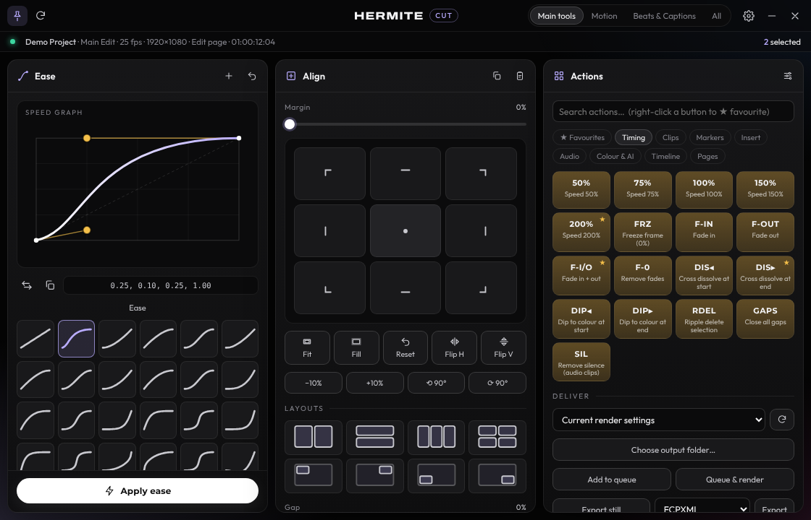
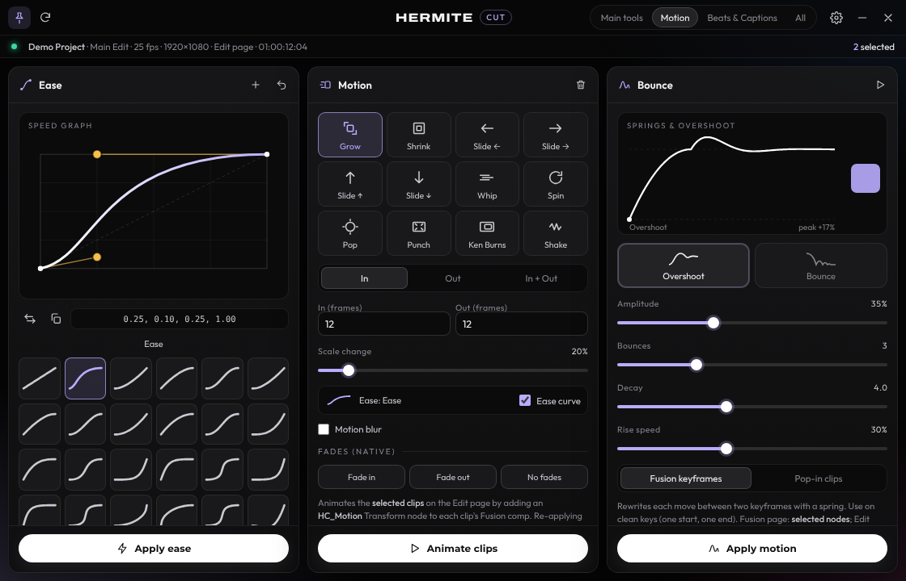
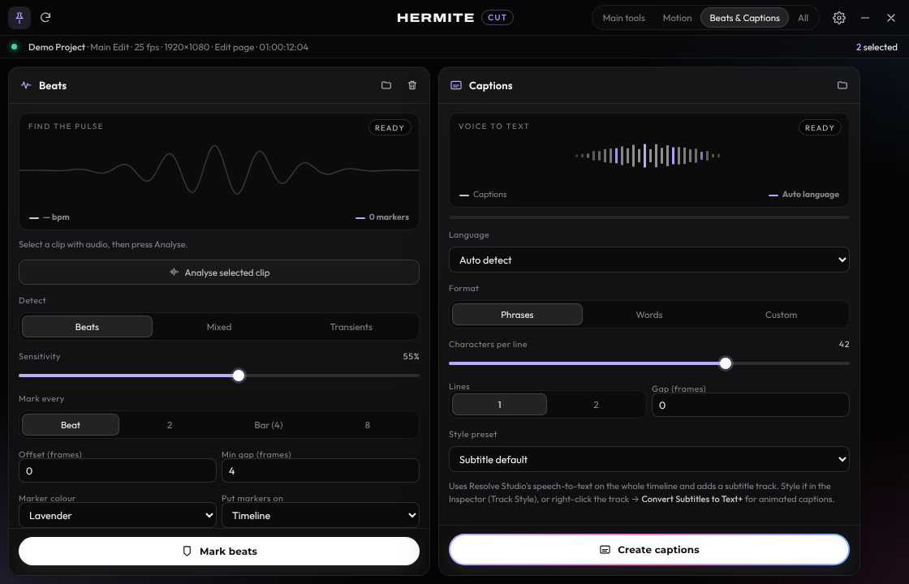

<div align="center">

# HermiteCut

**Motion, easing, alignment, beat markers, captions and 67 one-click edit actions for DaVinci Resolve Studio, in one floating panel inside Resolve.**

A [Hermite Labs](https://cut.hermitelabs.com) product.

<p>
<a href="https://github.com/gafaraleshe/HermiteCut/releases/latest/download/HermiteCut-Windows-Setup.exe"></a>
&nbsp;
<a href="https://github.com/gafaraleshe/HermiteCut/releases/latest/download/HermiteCut-Mac-arm64.dmg"></a>
</p>

<sub>Mac: Apple Silicon above, or <a href="https://github.com/gafaraleshe/HermiteCut/releases/latest/download/HermiteCut-Mac-x64.dmg">Intel</a>. First open on Mac: open it once, then <b>System Settings → Privacy &amp; Security → Open Anyway</b> (macOS 14 or older: right-click the app and choose <b>Open</b>). All files are on the <a href="https://github.com/gafaraleshe/HermiteCut/releases/latest">latest release</a>.</sub>


-222)
-444)




</div>

---

## What it is

HermiteCut adds a panel to DaVinci Resolve Studio
(**Workspace → Workflow Integrations → HermiteCut**) that floats over the Edit,
Fusion and Color pages. Its tools act on the clips you have selected:

- animate them with eased motion presets,
- line them up, split-screen them or blend them,
- drop markers on the beat,
- caption them,
- or run any of 67 one-click actions that normally take several menus.

Version 1.0 is a Resolve **Workflow Integration plugin**: an Electron app that
Resolve Studio loads and that talks to Resolve through its scripting API. Version
2 adds a standalone desktop app for Windows and macOS, Fusion template packs, a
sound-effects library and Shorts tools. See the [roadmap](docs/ROADMAP.md).

## Tools

| Tool | What it does |
|---|---|
| **Ease** | Bezier speed-graph editor with 30 presets and your own saved curves. It eases Fusion keyframes: on the selected nodes on the Fusion page, or every keyframe in the selected clips' Fusion comps on the Edit page. |
| **Align** | 3×3 align grid with margin, Fit / Fill / Reset / Flip, ±10 % scale and 90° rotate. Also split-screen and picture-in-picture layouts, blend modes and opacity, and copy / paste / save transforms. |
| **Actions** | 67 one-click actions in nine groups: Timing, Clips, Markers, Insert, Audio, Colour & AI, Timeline, Pages and ★ Favourites. Covers speed, fades, dissolves, ripple delete, close gaps, remove silence, loudness, voice isolation, stabilise, smart reframe, scene cuts, tracks, render queue, stills and timeline export. |
| **Motion** | Grow, Shrink, Slide ←→↑↓, Whip, Spin, Pop, Punch, Ken Burns and Shake for selected clips, as In, Out or both. Each preset is eased with your Ease curve and has optional motion blur. Native fade in / out is built in. |
| **Bounce** | Overshoot and bounce springs, either rewriting Fusion keyframes or as a spring pop-in on clips. You set amplitude, bounces, decay and rise speed. |
| **Beats** | Analyses the selected clip's audio, or any audio file, in the panel. It finds beats or transients and drops markers every beat, 2 beats, bar or 8 beats, on the timeline or on the clip. |
| **Captions** | Resolve Studio speech-to-text in 36 languages plus auto-detect. Phrases or Words format, characters per line, 1–2 lines, gap and style preset. You can also import `.srt` / `.vtt` subtitles. |

<table>
<tr>
<td></td>
<td></td>
</tr>
<tr><td align="center">Motion set</td><td align="center">Beats &amp; Captions set</td></tr>
</table>

## Requirements

- **DaVinci Resolve Studio 19 or newer**, tested on 21.2. Workflow Integration
  plugins are a Studio-only feature.
- **Windows 10 or 11** for the 1.0 installer.
- **macOS:** the plugin itself is cross-platform, but 1.0 has no Mac installer
  yet. The manual steps are in [docs/INSTALL.md](docs/INSTALL.md#macos-manual).

## Install

1. Download `HermiteCut-v1.0.0-windows.zip` from
   [Releases](https://github.com/gafaraleshe/HermiteCut/releases), or build it
   yourself (see [Building](#building-from-source)).
2. Extract it and run **Install HermiteCut.exe**. Windows asks for administrator
   permission because the plugin folder is under `C:\ProgramData`.
3. Restart DaVinci Resolve and open
   **Workspace → Workflow Integrations → HermiteCut**.

More detail, the no-exe installer, uninstalling and troubleshooting are in
**[docs/INSTALL.md](docs/INSTALL.md)**.

## Quick start

1. Open a timeline on the Edit page and select one or more clips.
2. **Motion**: choose *Grow* and *In + Out*, then press **Animate clips**.
3. **Ease**: choose a curve and press **Apply ease** to re-time the motion.
4. **Beats**: select your music clip, press **Analyse selected clip**, then **Mark beats**.
5. **Captions**: press **Create captions** to get a subtitle track from the dialogue.

The full walkthrough of every tool is in **[docs/USER_GUIDE.md](docs/USER_GUIDE.md)**.

## Documentation

| Document | For |
|---|---|
| [docs/INSTALL.md](docs/INSTALL.md) | Installing, updating, uninstalling, troubleshooting |
| [docs/USER_GUIDE.md](docs/USER_GUIDE.md) | Every tool and option, with tips |
| [docs/ARCHITECTURE.md](docs/ARCHITECTURE.md) | How the panel, the main process and Resolve talk to each other |
| [docs/BUILDING.md](docs/BUILDING.md) | Building the installer, developing and testing |
| [docs/RESOLVE_API_NOTES.md](docs/RESOLVE_API_NOTES.md) | Verified Resolve / Fusion scripting behaviour and workarounds |
| [docs/ROADMAP.md](docs/ROADMAP.md) | The v2 plan: standalone app, templates, SFX, Shorts |
| [CHANGELOG.md](CHANGELOG.md) | Release history |
| [AGENTS.md](AGENTS.md) | Full project context and working rules for developers and coding agents |

## Repository layout

```
plugin/            The Resolve Workflow Integration plugin (Electron)
  main.js          main process: window, IPC, Resolve connection
  preload.js       exposes window.hermite to the panel (context-isolated)
  lib/actions.js   every Resolve operation the panel can run
  lib/lua.js       Lua run inside Fusion comps (keyframes, motion nodes)
  lib/motion.js    motion preset maths
  index.html, css/, js/, fonts/, img/   the panel UI
crates/            the Rust version: installer, core, Resolve adapter, desktop app (docs/RUST_PLAN.md)
packaging/         files shipped next to the panel-only installer
scripts/           build scripts (Windows installer + zip) and a dev install script
tools/fusegen/     Python generator for Fusion macros (.setting) and .drfx packs (v2 templates)
tools/dev/         screenshots, test clips, frame checks and remote-debugging helpers
docs/              documentation and screenshots
```

## Building from source

```bash
scripts/build-windows.sh                 # Linux / macOS, needs Rust + MinGW
# or on Windows:
powershell -ExecutionPolicy Bypass -File scripts\build-windows.ps1
```

Both produce `dist/HermiteCut-v<version>-windows-panel.zip`, which contains the
installer `.exe`, the plugin folder, a no-exe `.bat` installer and an uninstaller.
For a quick development install straight from `plugin/`, run
`scripts\dev-install.bat` as administrator. See [docs/BUILDING.md](docs/BUILDING.md).

## Roadmap

HermiteCut 2.0 is in development:

- **Standalone app** for Windows (`.exe`) and macOS (`.dmg`) that drives Resolve
  over its external scripting bridge, and can still be opened from inside Resolve.
- **Template packs**: effects with start/end/both timing, shutter-angle and
  time effects, transitions, film burns, and fully editable text templates.
- **Built-in SFX library**: whooshes, risers, impacts, shutter clicks and more.
- **Asset library** that indexes your own LUTs, overlays, sounds and packs.
- **Shorts tools** for vertical 9:16 edits.

Details and status: **[docs/ROADMAP.md](docs/ROADMAP.md)**.

## Troubleshooting

- **No HermiteCut menu item**: Resolve only scans plugins when it starts, so
  restart it. The Workflow Integrations menu needs Resolve **Studio**.
- **"Not connected"**: open a project and a timeline, then press the refresh
  button (top left).
- **Something failed**: go to **Settings → Open log file**.

## License

MIT © 2026 Gafar / Hermite Labs. See [LICENSE](LICENSE) and
[THIRD_PARTY_NOTICES.md](THIRD_PARTY_NOTICES.md).

DaVinci Resolve is a trademark of Blackmagic Design. HermiteCut is not
affiliated with Blackmagic Design.
