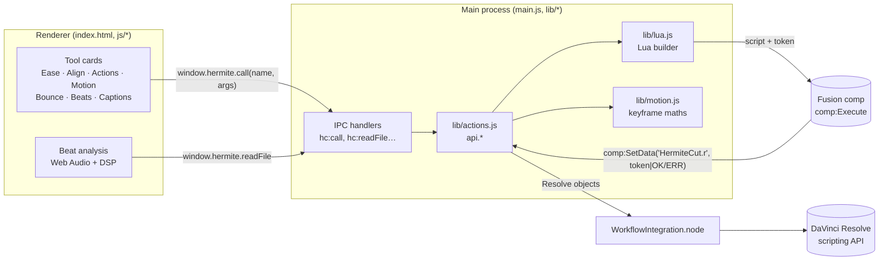

# Architecture

HermiteCut 1.0 is a DaVinci Resolve **Workflow Integration plugin**. That means
it is an Electron app that Resolve Studio itself starts from
**Workspace → Workflow Integrations**. It talks to Resolve through Blackmagic's
`WorkflowIntegration.node` bridge, which exposes the Resolve scripting API to
JavaScript.

## Files

| File | Role |
|---|---|
| `plugin/manifest.xml` | Plugin id (`com.hermitelabs.cut`), name, version and entry file. Resolve reads this at startup. |
| `plugin/package.json` | Electron app metadata. |
| `plugin/main.js` | Main process. Loads `WorkflowIntegration.node`, connects to Resolve, creates the frameless window, registers IPC and logs errors. |
| `plugin/preload.js` | Exposes `window.hermite` through `contextBridge`: `call`, `readFile`, `openFile`, `saveFile`, `chooseFolder` and `win`. |
| `plugin/lib/actions.js` | Every Resolve operation, as `api.<name>(args)`. |
| `plugin/lib/lua.js` | Builds the Lua scripts that run inside Fusion comps (easing, springs, motion nodes). |
| `plugin/lib/motion.js` | Turns a Motion preset, a curve and the clip geometry into keyframe lists. |
| `plugin/index.html` | The panel markup. Each tool is a `<section class="card" data-mod=… data-sets=…>`. |
| `plugin/js/core.js` | UI core: the `window.HC` helpers (`$`, `store`, `toast`, `call`, `seg`, `range`, `fitCanvas`, icons), connection polling and tool-set switching. |
| `plugin/js/math.js` | `window.HCMath`: bezier evaluation, the spring function and the 30 Ease presets. |
| `plugin/js/{ease,align,quick,motion,bounce,beats,captions,settings}.js` | One script per tool card. |
| `plugin/css/app.css` | Design tokens and layout. Fonts are bundled, so nothing loads from the network. |

## Process model and security

- Resolve starts the plugin's Electron main process. The window is frameless and
  sized 1120 × 720, with a minimum of 380 × 420.
- The renderer runs with `contextIsolation: true`, `sandbox: true` and
  `nodeIntegration: false`. A strict Content-Security-Policy in `index.html`
  allows only local scripts, styles, fonts and images.
- The renderer can only reach the main process through the six functions in
  `preload.js`. `win('openExternal', url)` opens only `http(s)` links.
- Resolve's plugin host doesn't keep Electron's always-on-top flag, so `applyPin()`
  sets it again on `show`, `restore` and `blur`.
- **Developer mode:** if an empty `devtools.flag` file exists next to `main.js`,
  Chromium remote debugging is enabled on `127.0.0.1:9339`. `tools/dev/cdp.py`
  uses this to drive the panel from scripts.

## IPC contract

`window.hermite.call(name, args)` → `ipcMain.handle('hc:call')` →
`actions.api[name](args)`.

- It resolves to `{ ok: true, result }` or `{ ok: false, error }`. The UI wrapper
  `HC.call()` shows a toast for either case.
- Errors are written to `hermitecut-log.txt` in Electron's `userData` folder
  (**Settings → Open log file**).
- If an error looks like a stale Resolve handle (`not initialized`, `invalid`,
  `disconnected`), the cached Resolve object is dropped. The next call reconnects.

## Talking to Resolve: bridge quirks

The JavaScript bridge differs from Resolve's Python and Lua APIs in a few ways.
`lib/actions.js` works around each one:

| Quirk | Work-around |
|---|---|
| Every call is asynchronous. | `await` everything, including property reads like `fu.CurrentComp`. |
| Methods that return nothing throw `Unknown object type` even though they ran. | `voidCall(fn)` swallows exactly that error. |
| Option objects with `undefined` or `null` values are rejected. | `clean(obj)` strips them before every call. |
| `resolve.*` enum constants (such as `resolve.EXPORT_FCPXML_1_10`) are not exposed. | A `CONST` table with the values read from Resolve 21.2. |
| `fusion.GetCurrentComp()` is missing. | Try `fu.CurrentComp`, then fall back to the comp of the clip under the playhead. |
| Indexed results (`GetItemListInTrack`, `GetMarkers`…) arrive as objects keyed `"1"`, `"2"`… | `arr()` turns them into arrays. |

More verified behaviour is collected in [RESOLVE_API_NOTES.md](RESOLVE_API_NOTES.md).

## Running Lua inside Fusion

Fusion work, such as re-easing splines or building the Motion node, is done in
Lua inside the comp. That is faster and more complete than going through the
bridge one call at a time.

1. `lib/lua.js` puts a small library (`HC.tools`, `HC.splines`, `HC.ease`,
   `HC.bounce`, `HC.applyMotion`, `HC.removeMotion`…) in front of the task body.
   It wraps the body in `pcall`, and in `comp:StartUndo()` / `comp:EndUndo()`
   so each task is one undo step.
2. `runLua()` swaps the placeholder `__HCTOKEN__` for a unique token and calls
   `comp.Execute(script)`.
3. `comp:Execute()` returns **before** the script finishes. The script reports
   with `comp:SetData("HermiteCut.r", "<token>|OK:<result>")` or
   `"<token>|ERR:<message>"`.
4. `runLua()` polls `comp.GetData('HermiteCut.r')` with a growing back-off,
   15 ms up to 120 ms, until it sees its token or 20 s pass. A timeout usually
   means a modal dialog is open in Resolve.

## How each tool works

**Ease.** On the Fusion page it works on the current comp's selected tools, or
all tools if nothing is selected and the option is on. On the Edit page it
works on every Fusion comp of the selected clips. `HC.splines` walks the tools'
inputs and their modifiers, up to 4 levels deep, to find every `BezierSpline`.
`HC.ease` rewrites the `RH` / `LH` handles of each segment from the
cubic-bezier, scaled to that segment's time and value range.

**Bounce.** The spring is sampled in JavaScript (`HCMath.spring`). `HC.bounce`
then replaces each moving segment with one linear key per frame that follows
the sampled curve.

**Motion.** `lib/motion.js` builds keyframe lists from the preset, the In and
Out lengths, the amount, the Ease curve (or a default) and the clip's timeline
geometry. These cover size, angle and centre X / Y. `HC.applyMotion` makes sure
a Transform named `HC_Motion` sits between the comp's image chain and
`MediaOut`, and keys it. It also renames an `EK_Motion` node from the
pre-release build if it finds one. Removing the motion reconnects `MediaOut`
and deletes the node.

**Align.** Works on Inspector properties (`Pan`, `Tilt`, `ZoomX/Y`,
`RotationAngle`, `Crop*`, `FlipX/Y`, `Opacity`, `CompositeMode`) through
`GetProperty` and `SetProperty`. `itemBox()` works out each clip's visible
rectangle in timeline pixels from its source resolution, the clip's (or
timeline's) scaling mode, zoom, pan, tilt and crop. The aligning and layouts are done with that
rectangle.

**Actions.** `api.quick({ id, arg })` is one `switch` over the action ids, run
on the selected clips, the timeline or the project as each case needs.
Deliver uses `GetRenderPresetList`, `LoadRenderPreset`, `SetRenderSettings`,
`AddRenderJob` and `StartRendering`.

**Beats.** Runs in the renderer:
1. `readFile` → `OfflineAudioContext.decodeAudioData`, giving 22.05 kHz mono.
2. Crop to the source range that is used on the timeline.
3. STFT (N = 1024, hop = 256, about 86 Hz) → low-band and full-band
   spectral-flux onset envelopes.
4. Tempo from an autocorrelation weighted towards about 120 bpm.
5. Beats from a dynamic-programming beat tracker (Ellis).
6. Transients from adaptive-threshold peak picking.

The marked times are mapped to timeline frames, allowing for the source in-point
and clip speed. `api.addBeatMarkers` then adds markers with
`customData = 'hermitecut-beat'`, which is how **Clear** finds them later.

**Captions.** `Timeline.CreateSubtitlesFromAudio()` with the language, preset,
characters per line, line count and gap settings. The *extended* languages also
set `extendedLanguageSupport`, and need that language pack installed in
Resolve's **Preferences → Speech**. Import goes through
`MediaPool.ImportMedia()` and appends the subtitle clip.

## Installer

`installer/main.go` builds one Windows `.exe` with the plugin folder embedded
(`//go:embed all:payload`; `scripts/build-*` fills `payload/`). It:

- removes any earlier copy, including the pre-release
  `com.gaffystudios.editkit.resolve` folder;
- copies the payload;
- copies `WorkflowIntegration.node` from the Resolve Studio install
  (`…\Support\Developer\Workflow Integrations\Examples\SamplePlugin\`,
  `SamplePromisePlugin\` or `CompatibleSamplePlugin\`);
- asks for elevation with `Start-Process -Verb RunAs` if the copy is refused.

## Where v2 goes

v2 keeps this plugin and adds a standalone desktop app that drives Resolve from
outside over `fuscript`. It uses a JSON-lines RPC with proxy objects, so that
`lib/actions.js` runs unchanged in both modes. See [ROADMAP.md](ROADMAP.md).
