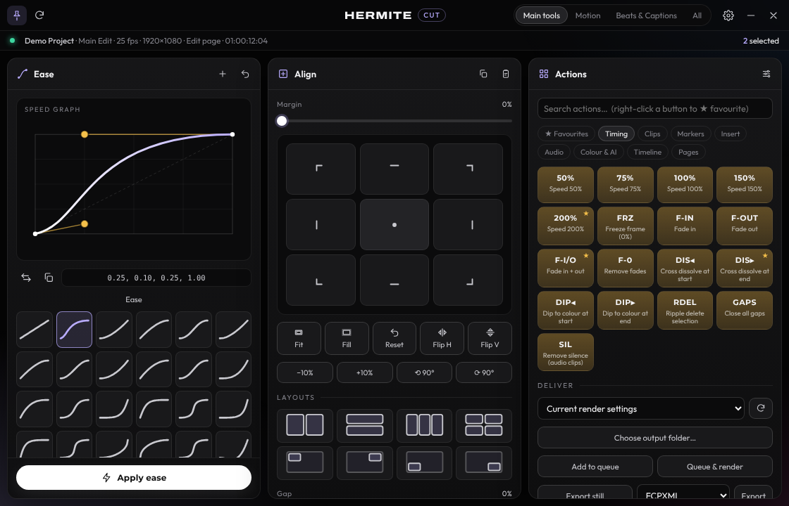
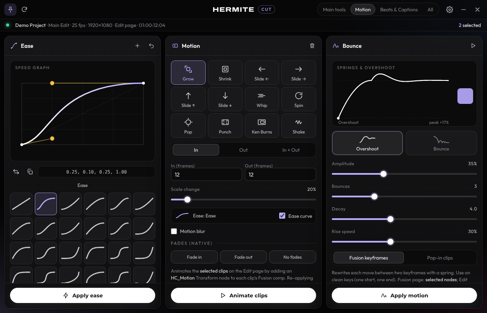
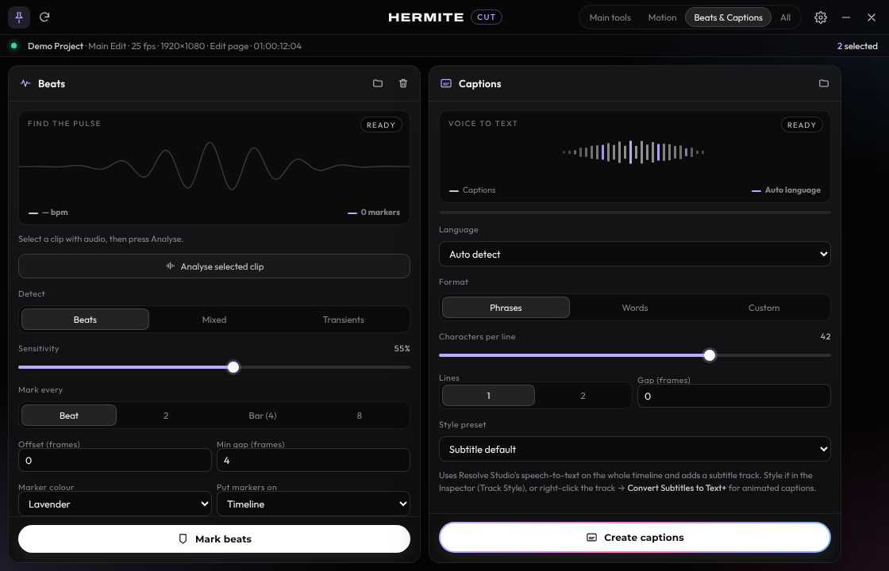

# HermiteCut user guide

HermiteCut works on whatever you have **selected in Resolve**. On the Edit page
that means the clips selected on the timeline. On the Fusion page it means the
selected nodes. Most tools also tell you in a toast how many clips they changed.

- [The panel](#the-panel)
- [Ease](#ease): speed-graph editor for Fusion keyframes
- [Align](#align): position, fit, layouts, blend and saved transforms
- [Actions](#actions): one-click actions and Deliver
- [Motion](#motion): animation presets for clips
- [Bounce](#bounce): spring and overshoot motion
- [Beats](#beats): beat and transient markers
- [Captions](#captions): speech-to-text subtitles
- [Settings](#settings)
- [Undo](#undo)

---

## The panel

| Part | What it does |
|---|---|
| **Pin** (top left) | Keeps the panel above Resolve. |
| **↻ Refresh** | Reconnects to Resolve and re-reads the project. |
| **Tool sets** | *Main tools*, *Motion*, *Beats & Captions* and *All*. *Main tools* can be customised in Settings. |
| **Status bar** | Project · timeline · fps · resolution · page · playhead timecode, plus the number of selected clips. The dot is green when the panel is connected. |
| **Toasts** | A short message after each action: what it did, or why it couldn't run. |

The window can be resized down to 380 × 420. Cards rearrange to fit, and
**Settings → Compact density** packs them tighter.

---

## Ease

A cubic-bezier **speed graph**. Drag the two yellow handles, or click the value
box and type four numbers (`x1, y1, x2, y2`). Values above 1 or below 0
overshoot.

- **30 presets**: Linear, Ease, Ease In / Out / In Out, the Sine, Quad, Cubic,
  Quint, Expo, Circ and Back families (In, Out and In Out), plus Snap, Smooth
  Glide, Whip and Anticipate. *Back* and *Anticipate* overshoot.
- **＋ Save** keeps the current curve as your own preset.
- **⇄ Reverse** swaps the in and out sides of the curve.
- **Copy** puts the `cubic-bezier()` values on the clipboard.
- **↺ Reset** goes back to *Ease*.

**Apply ease**
- *Fusion page:* rewrites the bezier handles of every keyframe on the **selected
  nodes**, including keys on modifiers such as paths.
- *Edit page:* applies the curve to every keyframe in the **selected clips'**
  Fusion comps.
- *No nodes selected → ease every animated node:* when nothing is selected on
  the Fusion page, eases the whole comp.

The curve is applied between each pair of neighbouring keyframes, so a move with
several keys is eased segment by segment. **Motion** uses the same curve when its
*Ease curve* option is on.

---

## Align

Works on clips selected on the Edit page. It uses each clip's **Inspector
transform** (Zoom, Position, Rotation, Flip, Crop), so the result stays editable.

- **Align grid (3 × 3):** moves each clip so its visible edge sits on that side
  of the frame. Cropping is taken into account. **Margin** keeps a gap, as a
  percentage of the frame.
- **Fit / Fill:** scales to fit inside the frame or to cover it. **Reset** clears
  transform and crop. **Flip H / Flip V** mirror the clip.
- **−10 % / +10 %** scale, and **⟲ 90° / ⟳ 90°** rotate.
- **Layouts:** split 2 side-by-side, split 2 stacked, 3 columns, 2 × 2 grid and
  picture-in-picture in each corner. Select clips on **stacked tracks**; the
  top track goes to the first slot. **Gap** adds space between the slots.
- **Blend & opacity:** Normal, Screen, Add, Multiply, Overlay, Soft Light,
  Lighten, Darken, Color Dodge or Difference, and opacity at 100 / 75 / 50 / 25 %.
- **Copy / paste transform** (card header buttons): copies position, zoom,
  rotation, anchor point, pitch / yaw, flip, crop, opacity and blend mode from
  one clip and pastes them onto the selected clips.
  **Save copied transform…** keeps it as a named preset for later.

---

## Actions

67 one-click actions, grouped as Timing, Clips, Markers, Insert, Audio,
Colour & AI, Timeline and Pages. Type in the search box to find one across all
groups. **Right-click** an action to add it to **★ Favourites**. The ⚙ button
holds the options some actions use.

| Group | Actions |
|---|---|
| **Timing** | Speed 50 / 75 / 100 / 150 / 200 %, freeze frame, fade in, fade out, fade in + out, remove fades, cross dissolve at start or end, dip to colour at start or end, ripple delete, close all gaps, remove silence (audio clips). |
| **Clips** | Enable or disable, delete (leave gap), link, unlink, make compound clip, make Fusion clip, set clip colour, red flag, clear flags. |
| **Markers** | Marker at playhead, markers at selected clip starts, next marker, previous marker, clear all timeline markers, clear markers on selected clips. |
| **Insert** | Text+ at the playhead, basic title, adjustment clip, solid colour, Fusion composition. |
| **Audio** | Normalise loudness, voice isolation, volume −6 / 0 / +3 dB. |
| **Colour & AI** | Auto colour balance, stabilise, smart reframe, grab still to gallery, scene cut detection. |
| **Timeline** | Add video or audio track, delete empty tracks, lock or unlock all tracks, In/Out to selection, clear In/Out, playhead to start or end, nudge playhead back or forward N frames, duplicate timeline, save project. |
| **Pages** | Media, Cut, Edit, Fusion, Color, Fairlight, Deliver. |

**Options (⚙):** fade / transition length in frames, marker colour, clip
colour, loudness target (LUFS), silence threshold (dB) and nudge size (frames).

**Deliver** (bottom of the card):
- Choose a **render preset** (↻ reloads the list) and an **output folder**.
  Then **Add to queue**, or **Queue & render** to start straight away.
- **Export still** saves the frame under the playhead.
- **Export** writes the timeline as FCPXML, FCP 7 XML, EDL, OTIO, CSV or DRT.

---

## Motion

Animates the **selected clips on the Edit page**. It adds a Transform node named
`HC_Motion` in each clip's Fusion comp, between the media and the output, and
keyframes it. Applying again replaces that node, so you can keep trying presets.

| Preset | Movement | Amount |
|---|---|---|
| Grow / Shrink | scale up or down | scale change % |
| Slide ← → ↑ ↓ | slides in from, or out to, that side | distance as % of the frame |
| Whip | fast slide with a strong ease | distance |
| Spin | rotation | % of a full turn |
| Pop | spring scale-in, using the Bounce settings | n/a |
| Punch | quick zoom hit | zoom % |
| Ken Burns | slow zoom over the whole clip | zoom % |
| Shake | camera shake | intensity |

- **In / Out / In + Out:** animate the start, the end, or both. **In (frames)**
  and **Out (frames)** set how long each part lasts.
- **Ease curve:** uses the curve from Ease. When it's off, a built-in ease is
  used.
- **Motion blur:** turns on the Transform node's motion blur.
- **Fades (native):** fade in, fade out or no fades, using Resolve's own clip
  fade handles.
- **🗑** removes HermiteCut motion from the selected clips.

---

## Bounce

Spring motion with four settings: **Amplitude**, **Bounces**, **Decay** and
**Rise speed**. The preview graph updates as you change them. Choose a style:

- **Overshoot:** goes past the end value and wobbles back. It settles over
  the number of *Bounces*.
- **Bounce:** hits the end value and bounces back off it, like a ball.

Then choose what it acts on:

- **Fusion keyframes:** rewrites each move between two keyframes as a sampled
  spring curve. This works best on clean keys with one start and one end. Undo
  with Ctrl+Z on the Fusion page.
- **Pop-in clips:** gives each selected clip a spring scale-in, using the
  `HC_Motion` node. **Pop duration** sets the length in frames.

---

## Beats

Beat detection runs **inside the panel**, so no audio is sent anywhere.

1. Select the music clip, or its audio, on the timeline. Then press
   **Analyse selected clip**. To use an audio file instead, press the file
   button; its markers start at the playhead.
2. The waveform appears with the detected tempo (bpm).
3. Choose what to mark:
   - **Detect:** *Beats* is a steady grid that follows the tempo. *Transients*
     marks every hit. *Mixed* uses both.
   - **Sensitivity:** higher values keep weaker beats and transients too.
   - **Mark every:** beat, 2 beats, bar (4) or 8 beats.
   - **Offset (frames):** shifts every marker earlier or later.
   - **Min gap (frames):** drops markers that are too close together.
   - **Marker colour**, and **Put markers on** the timeline or the clip.
4. Press **Mark beats**.

Only the part of the source that is used on the timeline is analysed. Speed
changes are taken into account, so markers land on the right frames. Markers are
tagged, so **🗑 Clear** only removes HermiteCut beat markers and leaves your own.

Supported audio: anything Chromium can decode, such as WAV, MP3, AAC/M4A, FLAC,
OGG, and the audio inside MP4, MOV and WebM files, up to 1.5 GB.

---

## Captions

Uses **Resolve Studio's speech-to-text** on the whole timeline and adds a
subtitle track.

- **Language:** auto-detect, or one of 36 languages. The ones marked
  *(extended)* may need a recent Resolve version.
- **Format:**
  - *Phrases*: about 42 characters, 2 lines.
  - *Words*: about 12 characters, 1 line, for punchy social captions.
  - *Custom*: set **Characters per line** and **Lines** yourself.
- **Gap (frames):** minimum space between captions.
- **Style preset:** Subtitle default or Netflix.

Press **Create captions** and wait while Resolve transcribes. Style the result
in the Inspector (*Track Style*). For animated captions, right-click the
subtitle track and choose **Convert Subtitles to Text+**. The file button imports
an existing `.srt` or `.vtt` instead.

---

## Settings

⚙ (top right):

- **Accent colour**, **Background glow** and **Compact density**.
- **Keep window on top of Resolve**: the default for the pin button.
- **Custom "Main tools" set**: choose which tools the *Main tools* tab shows.
- **Open log file**: errors are written to `hermitecut-log.txt` in the app's
  data folder.
- **Reset all settings**: clears presets, favourites and preferences.

---

## Undo

| Change | How to undo it |
|---|---|
| Edit-page changes (transform, speed, fades, markers…) | **Ctrl+Z** in Resolve. |
| Ease / Bounce on keyframes | Recorded as one undo step in the Fusion comp ("HermiteCut Ease" / "HermiteCut Bounce"). Press **Ctrl+Z** on the Fusion page. |
| Motion | Press **🗑** in Motion, or delete the `HC_Motion` node. |
| Beat markers | **🗑** in Beats. |
